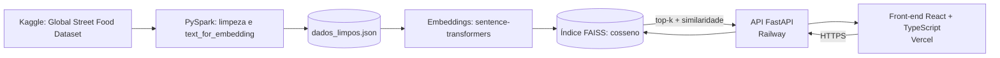
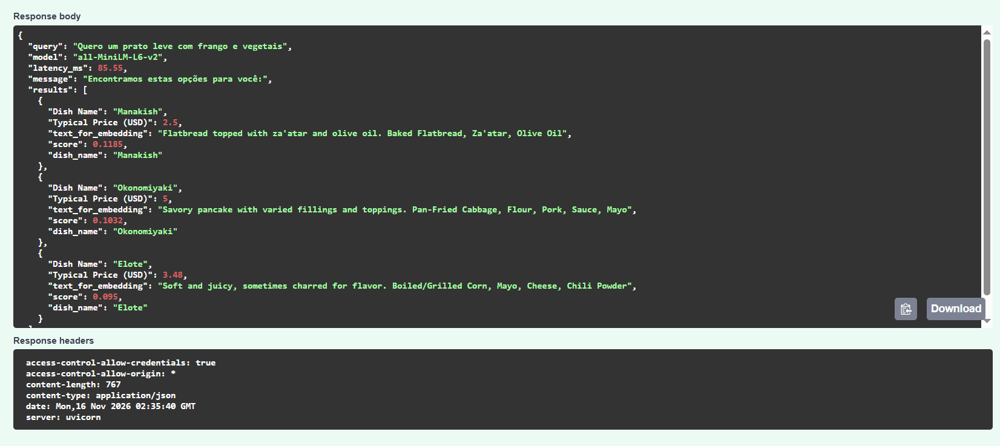

# Street Food Semantic Search

[](https://food-semantic-search.vercel.app)
[](./LICENSE)


**Busca semântica de pratos de rua:** descreva em linguagem natural o que você quer comer e receba os pratos mais parecidos, com a similaridade de cada um.

👉 **[Experimente online](https://food-semantic-search.vercel.app)**


---

## Sobre o projeto

Sistemas de recomendação costumam começar por uma etapa de **recuperação (retrieval)**: reduzir milhares de itens a alguns candidatos relevantes. Este projeto implementa essa etapa para pratos de rua, de ponta a ponta:

1. **Dados:** pipeline em PySpark que limpa e prepara 4.500 pratos de mais de 70 países.
2. **IA:** embeddings com `sentence-transformers` e índice vetorial FAISS, com similaridade por cosseno.
3. **Backend:** API REST em FastAPI.
4. **Frontend:** interface em React e TypeScript, publicada na Vercel.
5. **Avaliação:** conjunto de consultas rotuladas com métricas de recuperação.

> **Nota sobre o escopo:** o sistema faz **busca semântica**. Ele não é um agente autônomo. O foco é a etapa de recuperação.

## Como funciona



**Fluxo de uma busca:** o texto digitado vira um vetor com o mesmo modelo usado nos pratos → o FAISS devolve os vetores mais próximos → a API aplica o limite mínimo de similaridade e responde com os pratos, os scores e o tempo de resposta.

## Tecnologias

| Camada | Tecnologias |
|---|---|
| Dados | PySpark, kagglehub |
| IA e busca | sentence-transformers (`all-MiniLM-L6-v2`), FAISS |
| Backend | Python, FastAPI, Uvicorn, Pydantic |
| Frontend | TypeScript, React, Vite |
| Deploy | Railway (API) e Vercel (interface) |

## Estrutura do repositório

```
food-semantic-search/
├── app/          # API: rotas, configuração, esquemas e busca (embeddings + FAISS)
├── scripts/      # preparação dos dados (PySpark) e geração do índice
├── data/         # dados limpos (dados_limpos.json)
├── eval/         # consultas rotuladas e script de avaliação
├── frontend/     # interface em React + TypeScript
├── assets/       # imagens usadas neste README
├── requirements.txt
├── requirements-data.txt   # só para a etapa de dados (PySpark)
├── requirements-dev.txt
└── .env.example
```

## Como rodar localmente

**Pré-requisitos:** Python 3.11+ e Node.js 18+.

### Backend

```bash
git clone https://github.com/Vitoria-Emanuele/food-semantic-search.git
cd food-semantic-search

python -m venv venv
# Windows: venv\Scripts\activate    |    Linux/macOS: source venv/bin/activate
pip install -r requirements.txt

cp .env.example .env        
uvicorn app.main:app --reload
```

A API sobe em `http://localhost:8000`, com documentação interativa em `/docs`. Na primeira execução, o modelo de embeddings é baixado e o índice é criado; nas seguintes ele é lido do disco.

### Frontend

```bash
cd frontend
npm install
npm run dev
```

A interface abre em `http://localhost:5173` e conversa com a API local.

### (Opcional) Refazer os dados

```bash
pip install -r requirements-data.txt
python scripts/data_prep.py
```

Requer Java instalado (por causa do Spark). Para só rodar o projeto, não é necessário: `data/dados_limpos.json` já está no repositório.

## Uso da API

```bash
curl -X POST http://localhost:8000/sugerir-prato \
  -H "Content-Type: application/json" \
  -d '{"query": "Quero um prato leve com frango e vegetais", "top_k": 3, "min_score": 0.2}'
```

| Campo | Tipo | Descrição |
|---|---|---|
| `query` | texto | Pedido em linguagem natural |
| `top_k` | inteiro | Quantidade de pratos devolvidos (padrão 3) |
| `min_score` | número de 0 a 1 | Similaridade mínima; pratos abaixo disso são descartados |

**Resposta (exemplo):**



Outros endpoints: `GET /health` (status da API) e `GET /docs` (documentação interativa Swagger).

## Avaliação

Em vez de apenas "parece funcionar", a qualidade da busca é medida com **30 consultas** (inglês e português), das quais 5 estão **fora do tema** (por exemplo, "sports car"), usadas para verificar se o sistema evita devolver resultados sem relação.

- **Hit@k:** pelo menos um prato relevante aparece nos k primeiros.
- **Recall@k:** fração dos pratos relevantes que aparece nos k primeiros.
- **MRR:** média de 1 / posição do primeiro prato relevante.
- **Rejeição correta:** consultas fora do tema que não passam do limite mínimo de similaridade.
- **Latência:** p50 e p95 por busca.

| Modelo | Hit@1 | Hit@3 | Hit@5 | Recall@5 | MRR | Rejeição Correta | p50 (ms) | p95 (ms) |
| :--- | :---: | :---: | :---: | :---: | :---: | :---: | :---: | :---: |
| `sentence-transformers/all-MiniLM-L6-v2` | 0.48 | 0.64 | 0.64 | 0.64 | 0.55 | 80.0% | 38.06 | 88.58 |
| `sentence-transformers/paraphrase-multilingual-MiniLM-L12-v2` | 0.36 | 0.52 | 0.64 | 0.64 | 0.46 | 40.0% | 93.41 | 156.20 |

**Como reproduzir:** `python -m eval.run_eval`

**Limitações da avaliação:** o conjunto é pequeno (30 consultas) e foi rotulado por mim, antes de olhar os resultados do sistema, com o critério "o prato é relevante se bate com os ingredientes e o tipo de prato pedidos". Diferenças pequenas entre modelos devem ser lidas com cautela.

## Decisões de projeto e trade-offs

- **Deduplicação por nome do prato.** O dataset original repete o mesmo prato (ex.: *Quesadilla*) com variações de preço e local. Isso gerava vetores idênticos e fazia a busca sugerir o mesmo prato várias vezes. A regra `dropDuplicates(["Dish Name"])` no PySpark resolve isso e dá diversidade às sugestões, ao custo de perder histórico de preço e localização, que não eram necessários para a similaridade semântica.
- **Cosseno em vez de distância euclidiana.** Para embeddings de texto, a direção do vetor importa mais que a magnitude. Os vetores são normalizados e o índice usa produto interno (`IndexFlatIP`), o que equivale ao cosseno e permite devolver um score de 0 a 1 que a interface mostra como porcentagem.
- **Busca exata (`IndexFlat`).** Com cerca de 4.500 vetores, a busca exata é rápida e evita a perda de precisão de índices aproximados (como HNSW), que só compensam em escalas muito maiores.
- **Limite mínimo de similaridade (`min_score`).** Evita devolver resultados sem relação com a pergunta. O valor pode ser calibrado com as consultas fora do tema da avaliação.
- **Modelo e índice carregados uma vez.** São carregados na inicialização da API e o índice é persistido em disco, para que as buscas e os reinícios sejam rápidos.
- **PySpark para 4.500 linhas.** Usei PySpark para praticar um pipeline de dados com avaliação preguiçosa e transformações declarativas. Para este volume, o pandas resolveria com menos peso; a escolha é didática.

## Deploy

- **API:** [Railway](https://railway.app).
- **Interface:** [Vercel](https://food-semantic-search.vercel.app), configurada para chamar a API publicada.
- **Aprendizado:** o deploy exigiu tentativas em três plataformas (Render, Hugging Face Spaces e, por fim, Railway). A API carrega um modelo de embeddings, o que costuma exigir mais memória e tempo de inicialização do que planos gratuitos oferecem. Por isso, a **primeira requisição após um período sem uso pode ser mais lenta**.
- **CORS:** as origens permitidas são configuradas pela variável `CORS_ORIGINS` (veja `.env.example`).

## Limitações

- O dataset está em inglês e o modelo padrão é pequeno; consultas em português funcionam melhor com o modelo multilíngue (veja a tabela de avaliação).
- É só recuperação: o sistema não gera explicações nem converse com o usuário.
- Sem filtros por país, preço ou restrição alimentar (esses campos foram removidos na deduplicação).
- Sem autenticação nem limite de requisições na API pública.
- Os pratos têm descrição curta; a qualidade da busca depende do texto disponível por prato.

## Próximos passos

- Reranking com cross-encoder sobre os melhores candidatos.
- Busca híbrida (BM25 + vetorial) para nomes e ingredientes específicos.
- Filtros por metadados (país, tipo de prato, vegetariano).
- Camada de LLM para explicar por que cada prato foi recomendado.
- Testes automatizados e CI, e execução com Docker Compose.

## Dataset

[Global Street Food Dataset](https://www.kaggle.com/datasets/benjnb/global-street-food-dataset) (Kaggle), com 4.500 pratos de mais de 70 países. Consulte a licença do dataset na página original.

## Autora

**Vitória Emanuele de Sousa Silva**, Ciência de Dados e Inteligência Artificial, Universidade Federal da Paraíba.
[GitHub](https://github.com/Vitoria-Emanuele)

## Licença

[MIT](./LICENSE)
